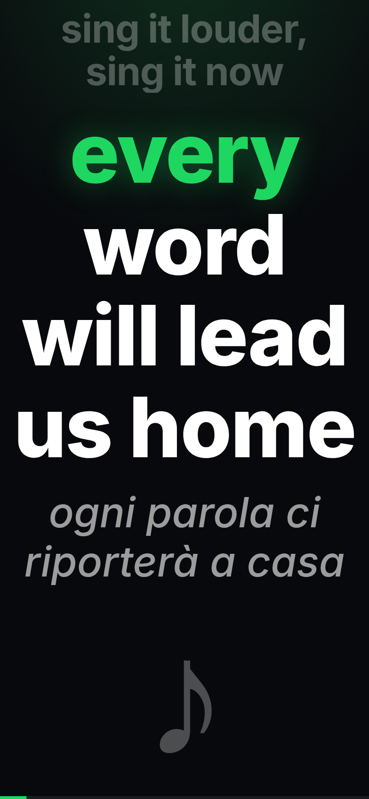
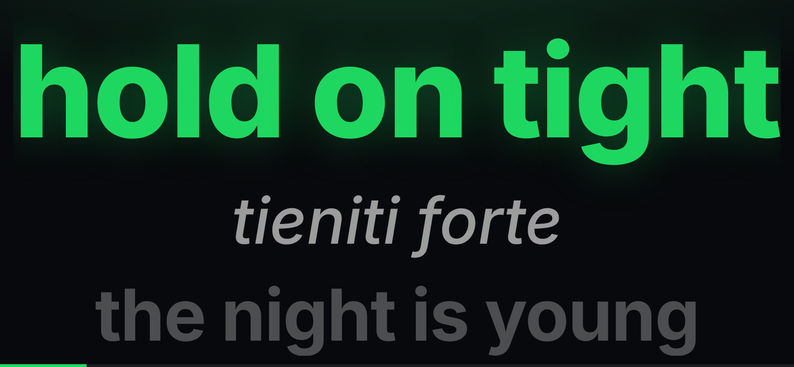
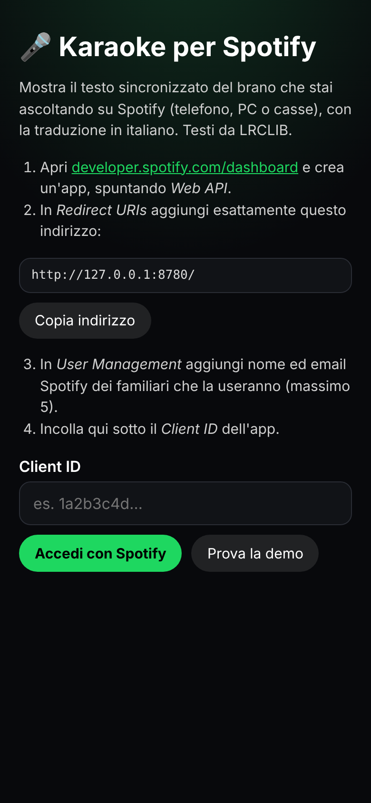
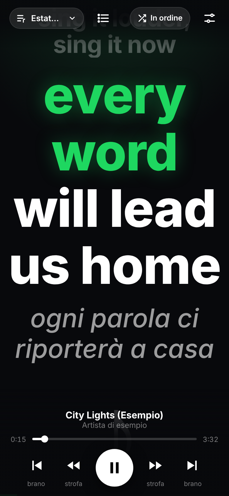
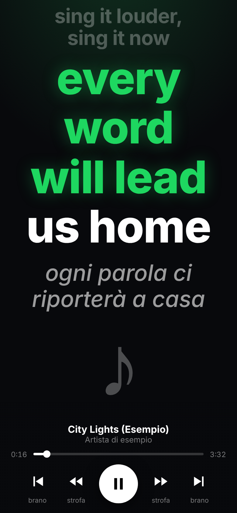
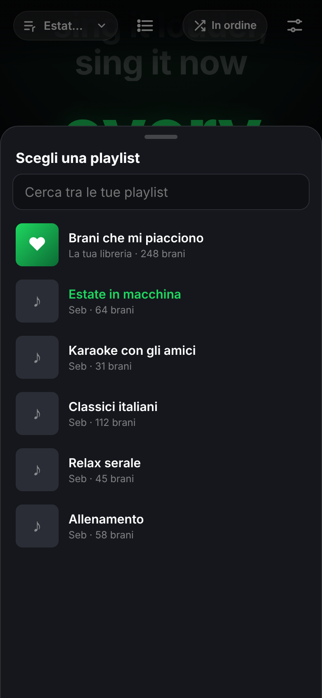
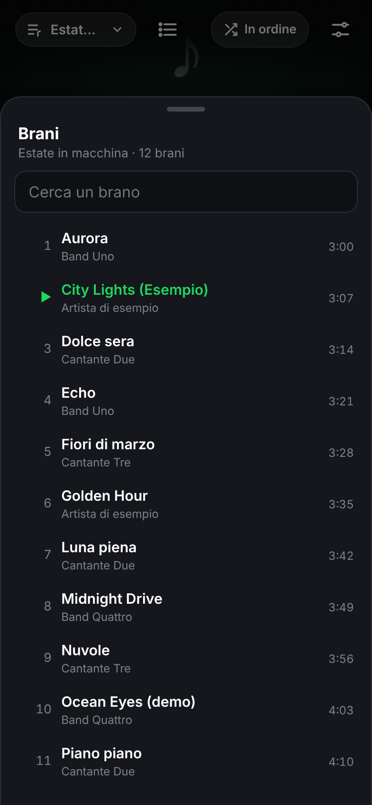
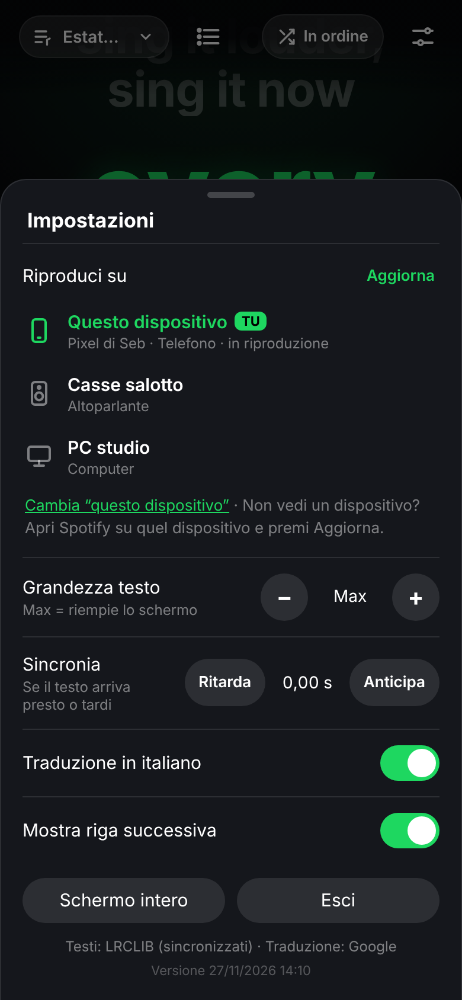

# 🎤 Karaoke Spotify

Web app (PWA) che mostra **in stile karaoke il testo sincronizzato** del brano che stai ascoltando su Spotify, con la **traduzione in italiano** sotto ogni riga. Dall'app controlli anche la riproduzione: pausa, salti tra strofe e brani, playlist, ordine e dispositivo.

**Indirizzo:** https://strovatogit.github.io/karaokespotify/

<p align="center">
  
  &nbsp;
  
</p>

> Gli screenshot usano dati di esempio: brani, testi e playlist sono inventati.

---

## Indice

- [Come funziona](#come-funziona)
- [Dipendenze](#dipendenze)
- [Installazione](#installazione)
- [Guida alle funzionalità](#guida-alle-funzionalità)
- [Limiti noti](#limiti-noti)
- [Struttura del progetto](#struttura-del-progetto)
- [Pubblicare un aggiornamento](#pubblicare-un-aggiornamento)
- [Privacy](#privacy)

---

## Come funziona

```
 Spotify (telefono, PC, casse)  ◄──── comandi: play, pausa, salti, playlist, dispositivo
          │
          │  brano in corso + posizione (lettura ogni 2–3 s)
          ▼
   ┌──────────────────────┐   testo sincronizzato (LRC)   ┌──────────┐
   │   Karaoke Spotify     │ ◄──────────────────────────── │  LRCLIB  │
   │   (questa web app)    │                                └──────────┘
   │                       │   traduzione in italiano       ┌──────────────────┐
   │                       │ ◄──────────────────────────── │ Google Translate │
   └──────────────────────┘                                └──────────────────┘
```

- **La musica la suona Spotify**, non l'app: telefono, PC, casse o qualsiasi dispositivo Spotify Connect.
- **Brano e posizione:** l'app li legge dalla Spotify Web API ogni 2–3 secondi. Nel frattempo calcola il tempo da sola, così le parole si colorano in modo fluido.
- **Testi:** arrivano da [LRCLIB](https://lrclib.net) in formato LRC, cioè con un timestamp per ogni riga.
- **Traduzione:** l'intero testo viene tradotto una volta sola, quando il brano cambia. Se il brano è già in italiano non compare nessuna traduzione.
- **Niente server:** l'app è un'unica pagina statica. Il login usa OAuth 2.0 con PKCE direttamente dal browser.

---

## Dipendenze

Il progetto **non ha dipendenze da installare**: niente npm, niente build, niente librerie esterne. È HTML, CSS e JavaScript in un solo file.

Servizi esterni usati:

| Servizio | A cosa serve | Requisiti |
|---|---|---|
| [Spotify Web API](https://developer.spotify.com/documentation/web-api) | Brano in corso, comandi di riproduzione, playlist, libreria, dispositivi | Un'app nella [Spotify Developer Dashboard](https://developer.spotify.com/dashboard) e account **Premium** |
| [LRCLIB](https://lrclib.net) | Testi sincronizzati | Nessuno, è gratuito e non richiede chiavi |
| Google Translate (endpoint pubblico `translate.googleapis.com`) | Traduzione in italiano | Nessuno. È un servizio gratuito **non ufficiale**, quindi può smettere di funzionare |
| Hosting statico in **HTTPS** (es. GitHub Pages) | Pubblicare l'app | Spotify accetta il ritorno dal login solo su `https://`, oppure su `http://127.0.0.1` per i test |

Permessi Spotify richiesti al login (scope):

| Scope | Uso |
|---|---|
| `user-read-currently-playing`, `user-read-playback-state` | Leggere brano, posizione, dispositivo e ordine casuale |
| `user-modify-playback-state` | Pausa, play, salti, ordine, cambio dispositivo |
| `playlist-read-private`, `playlist-read-collaborative` | Elenco playlist e relativi brani |
| `user-library-read` | "Brani che mi piacciono" |

Browser supportati: Chrome su Android (consigliato, installabile a schermo intero), Safari su iPhone/iPad, Chrome, Edge e Firefox su PC.

---

## Installazione

### 1. Crea l'app su Spotify

1. Vai su **https://developer.spotify.com/dashboard** e accedi con il tuo account Spotify, che deve essere Premium.
2. Premi **Create app**, scegli un nome (es. *Karaoke*) e spunta **Web API**.
3. In **Redirect URIs** aggiungi l'indirizzo esatto dell'app, **con la barra finale**:
   ```
   https://strovatogit.github.io/karaokespotify/
   ```
   Per provarla sul PC aggiungi anche `http://127.0.0.1:8000/`.
4. In **User Management** aggiungi nome ed email Spotify di ogni persona che userà l'app, te compreso, fino a un **massimo di 5**.
   > Per chi si è iscritto a Spotify con "Accedi con Apple" e l'email nascosta, l'indirizzo da inserire è quello `…@privaterelay.appleid.com`. Si trova su spotify.com/account.
5. Copia il **Client ID** dalla pagina dell'app.

### 2. Pubblica l'app

L'app è già pubblicata su GitHub Pages da questo repository: *Settings → Pages → Deploy from a branch → `main` / root*.

Per pubblicarla altrove basta copiare i file della cartella principale (`index.html`, `manifest.webmanifest`, `sw.js`, le icone) su un qualsiasi hosting **HTTPS**. Ricorda poi di aggiungere il nuovo indirizzo alle Redirect URIs.

Per provarla in locale sul PC:

```bash
python -m http.server 8000
# poi apri http://127.0.0.1:8000  (non "localhost": Spotify non lo accetta)
```

### 3. Primo accesso



1. Apri l'indirizzo dell'app.
2. La pagina mostra l'indirizzo esatto da usare come Redirect URI, con un pulsante per copiarlo.
3. Incolla il **Client ID** e premi **Accedi con Spotify**.
4. Autorizza l'app: ritorni alla schermata del karaoke.

Il pulsante **Prova la demo** mostra come funziona la visualizzazione senza collegarsi a Spotify.

<br clear="right">

### 4. Installala come app

- **Android (Chrome):** premi **Installa l'app** nella pagina iniziale o nelle impostazioni, oppure dal menu ⋮ di Chrome scegli *Installa app*. Si apre a schermo intero, con la sua icona.
- **iPhone/iPad (Safari):** pulsante Condividi → **Aggiungi alla schermata Home**.

Gli **aggiornamenti arrivano da soli**. Quando c'è una versione nuova l'app si ricarica e mostra "App aggiornata alla versione …". La versione installata si legge in fondo alle impostazioni.

---

## Guida alle funzionalità

### Testo karaoke


- **Riga corrente:** è al centro, **grande quanto possibile**. Le parole si colorano di verde mentre vengono cantate.
- **Traduzione:** sotto la riga, in corsivo.
- **Righe vicine:** in grigio, sopra la precedente e sotto la successiva.
- **Orientamento:** in orizzontale la riga corrente occupa quasi tutto lo schermo.
- **Sezioni strumentali:** al posto del testo compare **♪**.
- **Testo senza tempi:** se un brano ha solo il testo semplice, l'app lo mostra tutto da scorrere.
- **Schermo sempre acceso:** lo schermo non si spegne mentre l'app è aperta.

<br clear="right">

### Gesti sul testo

| Gesto | Effetto |
|---|---|
| **Tocco** sulla riga grande | Mostra o nasconde i comandi |
| **Tocco** sulla riga grigia sopra o sotto | Il brano salta a quella riga |
| **Scorrimento** a sinistra o a destra | Riga successiva o precedente |
| **Pizzico** con due dita | Allarghi per ingrandire il testo, stringi per rimpicciolirlo (da 1/10 a Max) |
| **Doppio tocco** | Fissa la barra in basso, oppure la rimette a comparsa |

### Comandi



**In alto**
- **Playlist in corso** (es. *Estate…*): toccala per scegliere un'altra playlist.
- **Elenco brani** (icona a lista).
- **Ordine:** *In ordine*, *Titolo*, *Cantante* o *Casuale*.
- **Impostazioni** (icona a cursori).

**In basso**
- Titolo e artista del brano.
- Barra di avanzamento: toccala o trascinala per spostarti nel brano.
- Pulsanti, da sinistra: **⏮ brano**, **⏪ strofa**, **play/pausa**, **strofa ⏩**, **brano ⏭**.

I comandi spariscono da soli dopo qualche secondo. Una linea verde sottile in fondo allo schermo mostra sempre l'avanzamento.

**Strofe:** sono i blocchi di testo separati da una riga vuota. Se il testo non ne ha, l'app usa blocchi di 4 righe. Se la strofa è iniziata da più di 2 secondi, ⏪ torna al suo inizio.

<br clear="right">

### Barra fissa



Con un **doppio tocco** sul testo la barra in basso resta sempre visibile. Il testo si sposta sopra la barra e si ridimensiona nello spazio che resta.

Un altro doppio tocco rimette la barra a comparsa. La scelta resta salvata.

<br clear="right">

### Playlist



Tocca il nome della playlist in alto per vedere tutte le tue playlist, con ricerca. Toccandone una, parte subito su Spotify.

**Brani che mi piacciono** è sempre il primo dell'elenco ed è la **playlist predefinita**. Se non sta suonando niente, play fa partire quelli.

<br clear="right">

### Elenco brani e ordine



**Elenco brani:** l'icona a lista apre i brani della playlist in corso, con ricerca e durata. Il brano in riproduzione è in verde. Toccando un brano parte quello, e la playlist continua da lì.

**Ordine:** il pulsante in alto gira tra tre modalità.

- **Titolo:** brani in ordine alfabetico per titolo.
- **Cantante:** in ordine alfabetico per artista, poi per titolo.
- **Casuale:** ordine casuale di Spotify.

Cambiando ordine, il brano in corso continua dal punto in cui eri. La scelta vale anche per le playlist che avvii dopo.

<br clear="right">

### Impostazioni



- **Riproduci su:** elenco dei dispositivi Spotify disponibili. Toccandone uno la musica passa lì.
  - **Questo dispositivo** (etichetta **TU**) è il telefono su cui stai usando l'app. Viene riconosciuto da solo, oppure lo indichi con *È questo*.
  - Play parte sempre su questo dispositivo, a meno che tu non abbia scelto un altro dispositivo dall'elenco.
  - Se Spotify non è aperto sul telefono, un pulsante **Apri Spotify** lo apre.
- **Grandezza testo:** − / + da 1/10 a **Max**, come il pizzico.
- **Sincronia:** *Ritarda* / *Anticipa* a passi di 0,25 s, se il testo arriva presto o tardi.
- **Traduzione in italiano** e **Mostra riga successiva:** interruttori per attivarle o disattivarle.
- **Installa l'app**, **Schermo intero**, **Esci** (disconnette l'account Spotify).
- In fondo: fonte dei testi e della traduzione, e **numero di versione**.

Tutte le scelte restano salvate sul dispositivo.

<br clear="right">

---

## Limiti noti

- **Modalità sviluppatore Spotify:** l'app Spotify creata nella dashboard permette **al massimo 5 utenti autorizzati**, aggiunti a mano in *User Management*. Tutti devono avere Spotify **Premium**. Per aprirla a tutti servirebbe l'accesso esteso di Spotify, che oggi è riservato ad app già affermate e su larga scala.
- **Brani delle playlist:** Spotify fornisce l'elenco dei brani **solo per le playlist create da te** e per i *Brani che mi piacciono*. Per le playlist di altri, comprese quelle di Spotify, l'elenco brani e l'ordine per titolo o cantante non sono disponibili. Si possono comunque far partire, anche in ordine casuale.
- **Copertura dei testi:** LRCLIB è un archivio di testi inseriti dagli utenti. I brani molto conosciuti ci sono quasi sempre, quelli meno noti a volte no oppure hanno solo il testo senza tempi.
- **Avanzamento parola per parola:** è una stima basata sulla lunghezza della riga. Precisa è la riga, non la singola parola.
- **Traduzione:** usa un servizio Google gratuito e non ufficiale, che potrebbe essere limitato o cambiare. Se non risponde, in fondo alle impostazioni compare "traduzione non disponibile".
- **Niente audio nell'app:** l'app non può suonare la musica da sola né abbassare la voce originale. La musica esce sempre da un dispositivo Spotify.
- **iPhone:** Safari non supporta lo schermo intero vero. L'app installata si apre senza barra degli indirizzi, ma con la barra di stato visibile.

---

## Struttura del progetto

```
index.html              App completa: interfaccia, stili e logica (nessuna dipendenza)
manifest.webmanifest    Manifest PWA: nome, icone, apertura a schermo intero
sw.js                   Service worker: installabilità, avvio offline, aggiornamenti automatici
icon-192.png            Icona app
icon-512.png            Icona app
icon-maskable-512.png   Icona adattiva per Android
apple-touch-icon.png    Icona per iPhone/iPad
docs/                   Screenshot usati in questo README
```

Parti principali di `index.html`:

- **OAuth PKCE:** login, scambio e rinnovo dei token.
- **Lettura stato:** `GET /me/player` ogni 2–3 secondi, con calcolo locale della posizione.
- **Testi e traduzione:** LRCLIB, parsing LRC, traduzione a blocchi con cache per brano.
- **Visualizzazione:** ricerca binaria della dimensione del carattere più grande che entra nel riquadro, ricalcolata a ogni riga e a ogni rotazione.
- **Comandi:** play e pausa, seek, next e previous, shuffle, transfer playback, playlist e libreria.

---

## Pubblicare un aggiornamento

1. Modifica `index.html` e aggiorna la costante `APP_VERSION`.
2. In `sw.js` incrementa il numero in `CACHE` (es. `karaoke-v14` → `karaoke-v15`).
3. Fai commit e push su `main`. GitHub Pages pubblica in 1–2 minuti, e le app installate si aggiornano da sole alla successiva apertura.

---

## Privacy

- Non c'è nessun server dell'app. Tutto avviene nel browser di chi la usa.
- Client ID, token di accesso Spotify e impostazioni sono salvati solo nel `localStorage` del dispositivo. **Esci** cancella il token.
- Le richieste partono dal dispositivo verso Spotify per riproduzione e libreria, verso LRCLIB con titolo, artista, album e durata del brano, e verso Google con il testo da tradurre.
